<p align="center"></p>

<h1 align="center">DuoBeam</h1>

<p align="center">
DuoBeam sends both screens of a dual-screen Android handheld to a TV over Wi-Fi, together with the game sound.<br>
Made and tested on the AYN Thor; single-screen handhelds are handled too (see <a href="#devices">Devices</a>).<br>
The receiver runs on Samsung TVs (Tizen) and on Android TV / Google TV. You don't need a PC, a cable or root.
</p>

<p align="center"><a href="README.pl.md">Polska wersja</a></p>

<p align="center">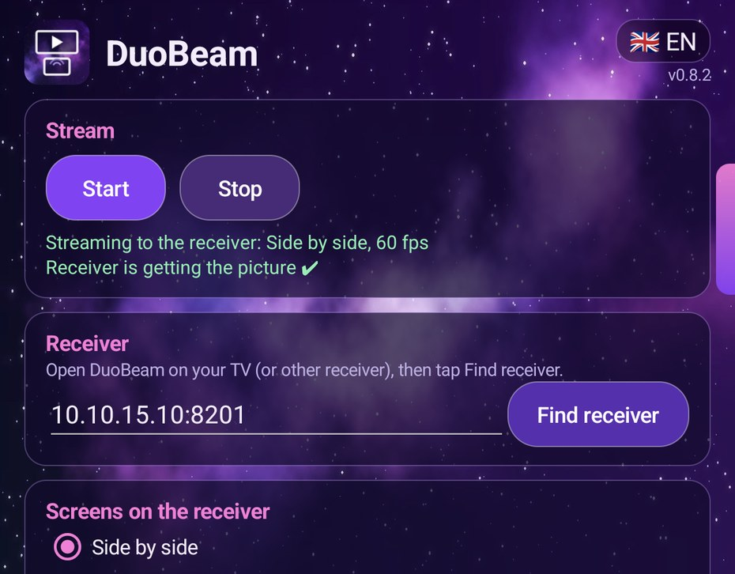</p>

<p align="center">
<b>Videos:</b> <a href="https://www.youtube.com/watch?v=C4tcTBTjeMU">setup from scratch</a> · <a href="https://www.youtube.com/watch?v=QhAqw3-BiSg">streaming both screens to a TV</a>
</p>

The videos start with DuoBeam already installed. Copying the APK to the handheld or the TV and installing the Samsung receiver
are not shown: see [Install](#install). An Android TV takes the APK from a USB stick and a file manager,
and for Samsung TVs there are many sideloading guides online besides the steps below.

## Why I made it

I wanted to play games from my Thor on the TV and still see both screens.
I have a Samsung TV and wanted the picture to go straight to it, not through a PC and not over cables.
At the time I couldn't find any software that did this the way I needed, so I made DuoBeam:
open the receiver on the TV, press Start on the Thor, and play.

## What it does

**On the Thor**
- Five layouts: side by side, one above the other, big top screen with a small bottom one, top only, bottom only. You can switch while playing.
- 60 fps HEVC (H.265) video with three quality levels. When Wi-Fi gets congested, late frames are dropped and the bitrate goes down for a moment, then recovers.
- Game sound on the TV only, on the TV and the Thor, or on the Thor only. Without a receiver, the Thor keeps its sound as usual.
- "Picture only on the TV": the backlight of one or both Thor screens turns off. Buttons keep working. Touch on a dark screen can be blocked or kept on. Tap a dark screen 3 times quickly to turn it back on.
- Control while playing from a side bar on the bottom screen, from the notification, or from a Quick Settings tile.
- English and Polish.

**On the TV**
- Samsung plays the stream with its low-latency player (the ultra-low latency mode Samsung describes for game streaming). TVs without that player fall back to the regular one automatically.
- Android TV decodes in hardware straight to the screen.
- Same remote keys on both: **OK** shows the delay meter, **↑/↓** picks lowest delay / balanced / smoothest, **←/→** switches the language.

### Layouts

Frames taken from the stream itself, shown in a 16:9 frame the way a TV displays them.
Top screen: the Thor's home screen, bottom screen: the DuoBeam app.

| Side by side | Top above bottom | Top + small bottom on the right |
|---|---|---|
| 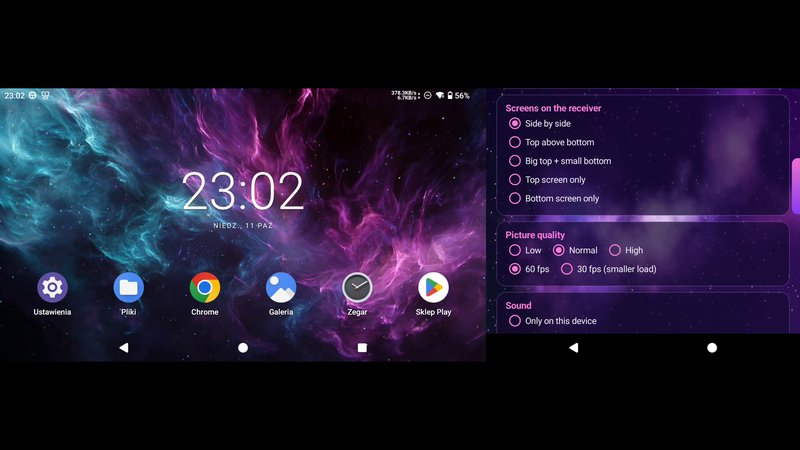 | 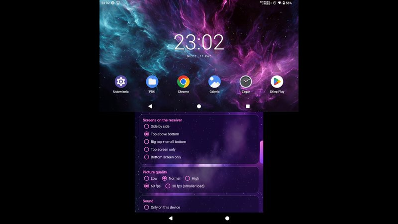 | 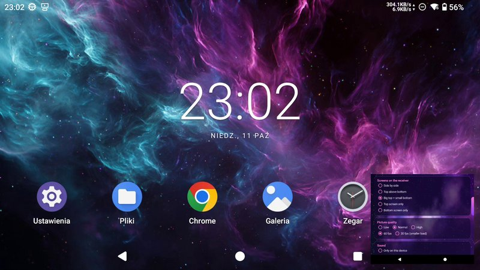 |
| **Top screen only** | **Bottom screen only** | |
| 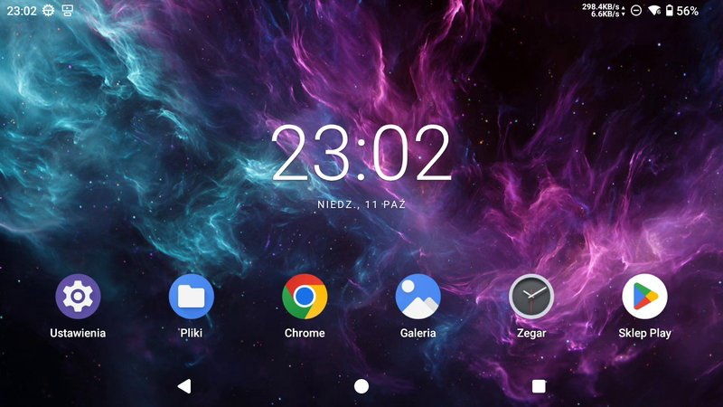 | 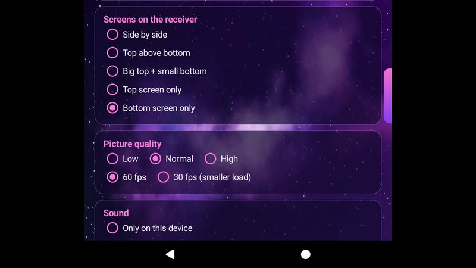 | |

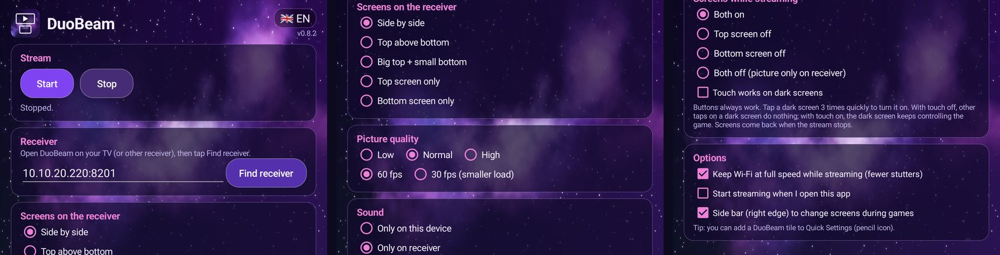

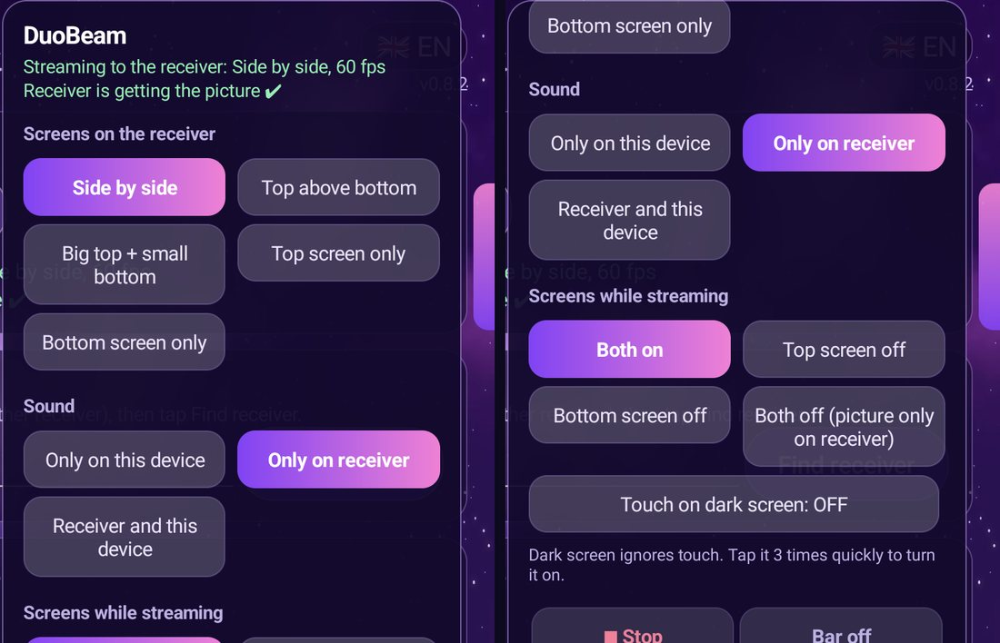

## Devices

DuoBeam is made and tested on the **AYN Thor** (Android 13).
The app looks for the device's built-in screens itself, so it should also work on single-screen Android handhelds
(Anbernic, Retroid, AYN Odin and similar): it then sends the one screen and hides the options that only make sense with two.
I haven't tested this on such a device yet; reports are welcome.

What the handheld needs:
- Android 11 or newer, 64-bit ARM
- a hardware HEVC (H.265) video encoder
- Wi-Fi (Wireless debugging only works on Wi-Fi)

## How it works

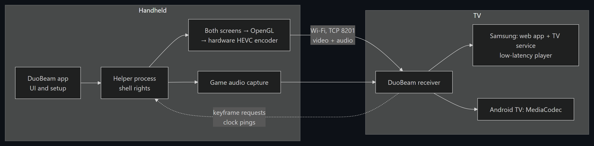

**The helper process.** A normal Android app can't record the second screen, can't record game audio
without asking each time, and can't turn a screen's backlight off. Android's shell user can.
So during setup DuoBeam pairs itself with Android's *Wireless debugging* (Shizuku gets its access the same way)
and then starts a small helper process with shell rights. All capturing and encoding happens in that helper.
It only listens on 127.0.0.1 and only accepts commands with a random token that the app holds.
If the app goes away, the helper stops by itself within about 5 seconds.

**Video.** The helper mirrors both screens into one OpenGL texture in the chosen layout,
encodes it with the Thor's hardware HEVC encoder at a constant 60 fps, wraps each frame in an fMP4 fragment,
and sends it over TCP. Frames older than 150 ms are dropped instead of sent late.
If the TV reports that it fell behind, the next frame is a keyframe.

**Audio.** Game and media audio is captured with Android's playback capture and sent with the video
as uncompressed PCM, which both TV players play reliably. In "TV only" mode the sound is taken away from the Thor speakers,
in "TV and Thor" it plays in both places.

**Receivers.** On Samsung the receiver is a Tizen web app with a small Node service on the TV.
The service accepts the TCP stream, and the page feeds Samsung's Elementary Media Stream Source
in its ultra-low latency mode, which Samsung documents for game streaming. On Android TV the frames go into `MediaCodec`, which renders directly to the screen,
and the sound goes into an `AudioTrack`.

**Delay meter.** The Thor timestamps every frame and the receiver keeps its clock in sync with short pings,
so the receiver can show how long each frame spent on the Thor, on Wi-Fi and on the TV.

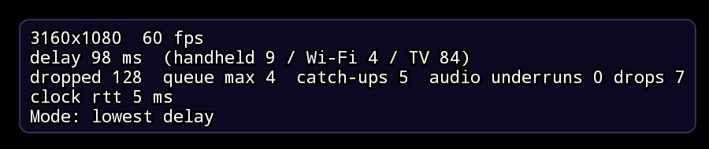

Built-in meter in 0.8.3, from the new picture on the Thor until the TV player has the frame
(measured 2026-10-12, side by side, 60 fps). The TV's own picture processing after that point is not included:

| receiver | meter |
|---|---|
| Samsung QE43Q67C (2023, Tizen 8), low-latency player | ~45 ms |
| Xiaomi TV MiTV-MOOQ0 (Android TV 11), lowest delay mode | ~100–130 ms |

Two camera recordings of the Thor and the Xiaomi TV together (same day, same scene) showed ~133 ms and ~200 ms
from the Thor's screen to the TV's screen. During the second one the Wi-Fi was congested and the meter read 64–103 ms,
so this TV adds time after the point where the meter stops, and apps cannot see that part.

## Install

You need the Thor and the TV on the same network (separate VLANs work if they can reach each other).
The receiver uses TCP ports **8201** (stream) and **8202** (discovery and status).
Install the receiver on the TV first, then the app on the Thor.

### 1a. Android TV / Google TV receiver

Get `DuoBeam-androidtv-<version>.apk` from [Releases](../../releases) and install it with one of these:

- **Obtainium**, if you use it on the TV. It adds this repository with a filter for the TV receiver APK and keeps it updated.

  <a href="https://apps.obtainium.imranr.dev/redirect?r=obtainium://app/%7B%22id%22%3A%22com.duobeam.tv%22%2C%22url%22%3A%22https%3A%2F%2Fgithub.com%2FGengaroshi%2Fduobeam%22%2C%22author%22%3A%22Gengaroshi%22%2C%22name%22%3A%22DuoBeam%20TV%22%2C%22additionalSettings%22%3A%22%7B%5C%22apkFilterRegEx%5C%22%3A%20%5C%22DuoBeam-androidtv-.%2A%5C%5C%5C%5C.apk%24%5C%22%7D%22%7D"></a>

- **Downloader** (by AFTVnews, in the Play Store on the TV): type the APK's download link and install it.
- **USB stick**: copy the APK to it, plug it into the TV and open the file in a file manager.
- **Send Files to TV** or any file manager: copy the APK from your phone, then open it on the TV.
- **adb**, if you have it: turn on debugging in the TV's *Developer options* (on many TVs it's called USB or network debugging), then `adb connect <tv-ip>` and `adb install DuoBeam-androidtv-<version>.apk`.

Android asks once whether the app you used may install apps; allow it.
Open **DuoBeam TV** from the app list. It shows its address and waits.

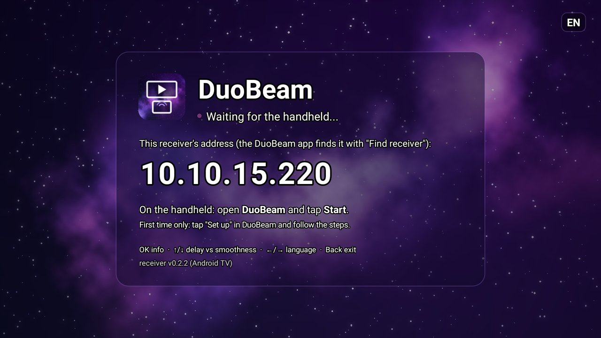

### 1b. Samsung TV (Tizen) receiver

Samsung doesn't let you install apps from outside its store unless the TV is in Developer Mode,
and every such app must be signed with a certificate made for your Samsung account and your TV.
That's why there is no file you can just copy to the TV. The steps below are the same ones used for Jellyfin or Moonlight on Samsung TVs.

**Turn on Developer Mode (once)**
1. Check your PC's IP address (on Windows: `ipconfig`). The PC and the TV must be on the same network.
2. On the TV open **Apps**, then type **1 2 3 4 5** on the remote (or on the on-screen number pad, if your remote has no numbers).
3. Switch **Developer mode** to **On**, enter your PC's IP address and confirm.
4. Restart the TV: hold the power button until the logo appears, or unplug it for 30 seconds.

**Option A: Apps2Samsung (easiest)**
1. Download [Apps2Samsung](https://github.com/Apps2Samsung/Apps2Samsung) for your system and start it.
2. Sign in with a Samsung account when it asks. It creates the certificate for your TV from that.
3. Pick your TV, choose to install your own `.wgt` file, select `DuoBeam-tizen-<version>.wgt` from [Releases](../../releases) and install.
   The file in Releases is not signed; signing it for your TV is what Apps2Samsung does.
   I install with Tizen Studio myself and haven't tried this route with DuoBeam yet, so a report is welcome.

**Option B: Tizen Studio**
1. Install [Tizen Studio](https://developer.tizen.org/development/tizen-studio/download) with *TV Extensions* and *Samsung Certificate Extension* from the Package Manager.
2. In *Certificate Manager* create a **Samsung** certificate profile for **TV**, signed in with your Samsung account. With the TV connected, its ID is added to the certificate.
3. From this repository:
   ```bash
   cd tizen-receiver
   ./deploy.sh <tv-ip> <certificate-profile-name>
   ```
   On Windows run it in Git Bash and point it to the tools:
   `TIZEN=/c/tizen-studio/tools/ide/bin/tizen.bat SDB=/c/tizen-studio/tools/sdb.exe ./deploy.sh <tv-ip> <profile>`

Then open **DuoBeam** from the TV's apps. It shows the same waiting screen as the Android TV receiver.

Good to know:
- The TV accepts installs only from the PC whose IP you entered in Developer Mode. If you use another PC, change it there.
- Update with the same tool and certificate you used the first time. If the install fails with a certificate error, uninstall DuoBeam from the TV first.
- Tested on a 2023 Q67C (Tizen 8). Models without the low-latency player fall back to the regular player automatically; on my TV the regular player had about 250 ms of delay.

### 2. The app on the Thor

1. Install `DuoBeam-handheld-<version>.apk` from [Releases](../../releases). If Play Protect warns about an unknown app, choose *More details → Install anyway*.
   With [Obtainium](https://github.com/ImranR98/Obtainium) you also get updates:

   <a href="https://apps.obtainium.imranr.dev/redirect?r=obtainium://app/%7B%22id%22%3A%22com.duobeam.app%22%2C%22url%22%3A%22https%3A%2F%2Fgithub.com%2FGengaroshi%2Fduobeam%22%2C%22author%22%3A%22Gengaroshi%22%2C%22name%22%3A%22DuoBeam%22%2C%22additionalSettings%22%3A%22%7B%5C%22apkFilterRegEx%5C%22%3A%20%5C%22DuoBeam-handheld-.%2A%5C%5C%5C%5C.apk%24%5C%22%7D%22%7D"></a>

   (or add `https://github.com/Gengaroshi/duobeam` in Obtainium yourself and pick the `DuoBeam-handheld` file).

2. Open DuoBeam and go through **One-time setup**:
   - Developer options must be on: *Settings → About → tap "Build number" 7 times*.
   - Tap **Set up**. Developer options open on the other screen, so the DuoBeam screen stays visible.
   - Go to *Wireless debugging → Pair device with pairing code* and type the 6-digit code into DuoBeam.

   After pairing, DuoBeam can turn Wireless debugging on by itself, so you don't have to repeat this after a restart.
   Wireless debugging only works on Wi-Fi, which DuoBeam needs anyway.
3. Tap **Find receiver**, pick your TV from the list and tap **Start**.

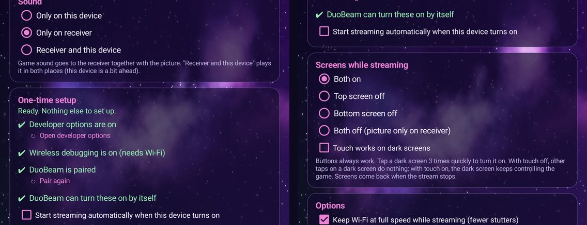

## Tips and problems

- **Find receiver doesn't find the TV.** Make sure the receiver is open on the TV. If your TV is in another subnet, type the address shown on the TV into the field. Once a receiver was used, it is checked first next time.
- **Stutters.** Leave *Keep Wi-Fi at full speed* on, use 5 GHz Wi-Fi, try a lower quality or 30 fps, or press ↑/↓ on the TV for the *balanced* mode.
- **The side bar doesn't appear.** It only shows while streaming, and it needs the *Display over other apps* permission. While that permission is missing, DuoBeam shows a shortcut to it under the side bar option.
- **"Pair again".** Needed after clearing DuoBeam's data or if you revoke the debugging authorizations in Developer options.

## Build from source

Handheld app and Android TV receiver need JDK 17+ and the Android SDK (platform 36):

```bash
cd thor-app/android && ./gradlew assembleRelease
cd androidtv-receiver && ./gradlew assembleRelease
```

Without a signing setup the release build is signed with your debug key, which is fine for your own devices.
To sign with your own key, point `DUOBEAM_SIGNING` at a properties file with `storeFile`, `storePassword`, `keyAlias` and `keyPassword`.

The Samsung receiver is packaged and installed by `tizen-receiver/deploy.sh` (see above).

The helper can also run alone from `adb shell`, which is handy when working on the encoder:

```bash
cd thor-app
ANDROID_HOME=~/Android/Sdk ./build.sh
adb push build/duobeam.jar /data/local/tmp/
adb shell CLASSPATH=/data/local/tmp/duobeam.jar app_process / com.duobeam.Sender tv=<TV-IP>:8201 layout=side audio=tv
```

## Project layout

```
thor-app/
  src/com/duobeam/          the helper: capture and layout, HEVC encoder, fMP4 muxer, audio, screen power, control port
  android/                  the app: UI, pairing, side bar, notification, Quick Settings tile (contains the helper)
  third_party/scrcpy/       scrcpy 4.1 server sources, used for Android's hidden display and input APIs (unmodified)
androidtv-receiver/         Android TV receiver
tizen-receiver/
  service/service.js        Node service on the TV: TCP 8201 for the stream, HTTP 8202 for discovery and status
  js/emss.js                low-latency player (Samsung Elementary Media Stream Source)
  js/player.js              fallback player, waiting screen, delay meter
  deploy.sh                 package and install on the TV
docs/                       README images and the diagram source
```

The stream is a sequence of messages `[length u32][type u8][payload]`:

| type | content |
|---|---|
| 0 | codec string and fMP4 init segment |
| 1 / 2 | keyframe / other frame (one fMP4 fragment) |
| 4 | layout is changing |
| 5 | audio frame |
| 6 | frame timestamps for the delay meter |
| 8 / 9 | clock ping / reply |
| 10 | receiver asks for a keyframe |

## Security and privacy

- No accounts, logins or API keys. DuoBeam never asks for credentials.
- No internet connections, analytics or telemetry. All traffic stays in your local network: handheld → TV on TCP 8201 and 8202.
- The stream isn't encrypted, so use DuoBeam on a network you trust.
- The helper on the handheld only listens on 127.0.0.1 and needs a random token that only the app knows. The token is masked in logs.
- The Wireless debugging pairing key stays in the app's private storage. After pairing, DuoBeam grants itself `WRITE_SECURE_SETTINGS` so it can turn Wireless debugging back on after a restart. To undo this, remove DuoBeam from *Developer options → Wireless debugging → Paired devices* and uninstall the app.

## Plans

Receivers for Windows, Linux and macOS.

## How it was made

DuoBeam was built with Claude Code, Anthropic's AI coding assistant. Most of the code and documentation was written by it, not typed by me. My part: deciding what the app should do and how it should behave, testing every build on my Thor and TVs, reporting what was broken and deciding what goes in. Commits it worked on are marked with `Co-Authored-By: Claude`.

## Feedback

DuoBeam is a hobby project. If you try it, I'd like to hear how it went, especially on handhelds other than the Thor.
Found a bug or have an idea? Open an [issue](../../issues) and include your handheld model, Android version,
the TV or receiver you used and what happened. I'll try to answer, though it can take a few days.

If DuoBeam is useful to you and you'd like to say thanks, you can leave a tip on Ko-fi:

<a href="https://ko-fi.com/gengaroshi"></a>

## License

Apache License 2.0, see [LICENSE](LICENSE). Bundled third-party code (scrcpy, libadb-android, sun-security-android, Conscrypt) is listed in [NOTICE](NOTICE).

AYN, Thor, Samsung, Tizen and Android TV are trademarks of their owners. DuoBeam is an independent project and is not affiliated with them.
