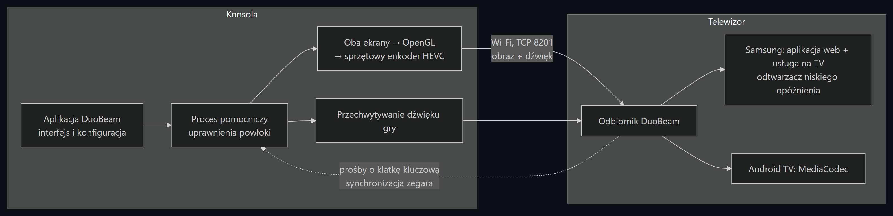

<p align="center"></p>

<h1 align="center">DuoBeam</h1>

<p align="center">
DuoBeam przesyła oba ekrany dwuekranowej konsoli z Androidem na telewizor przez Wi-Fi, razem z dźwiękiem gry.<br>
Powstał i jest testowany na AYN Thorze; konsole z jednym ekranem też są obsługiwane (zobacz <a href="#urządzenia">Urządzenia</a>).<br>
Odbiornik działa na telewizorach Samsunga (Tizen) i na Android TV / Google TV. Bez komputera, kabli i roota.
</p>

<p align="center"><a href="README.md">English version</a></p>

<p align="center"></p>

## Skąd ten projekt

Chciałem grać na Thorze na telewizorze i dalej widzieć oba ekrany.
Mam telewizor Samsunga i chciałem, żeby obraz szedł prosto na niego, bez komputera po drodze i bez kabli.
Nie znalazłem wtedy oprogramowania, które robiłoby to tak, jak potrzebowałem, więc zrobiłem DuoBeam:
otwierasz odbiornik na TV, naciskasz Start na Thorze i grasz.

## Co potrafi

**Na Thorze**
- Pięć układów: obok siebie, jeden pod drugim, duży górny ekran z małym dolnym, tylko górny, tylko dolny. Można je zmieniać w trakcie gry.
- Obraz HEVC (H.265) w 60 kl/s, trzy poziomy jakości. Kiedy Wi-Fi się zapycha, spóźnione klatki są pomijane, a bitrate na chwilę spada i potem wraca.
- Dźwięk gry tylko na TV, na TV i na Thorze albo tylko na Thorze. Bez odbiornika Thor gra normalnie.
- „Obraz tylko na TV”: podświetlenie jednego albo obu ekranów Thora się wyłącza. Przyciski działają dalej. Dotyk na ciemnym ekranie można zablokować albo zostawić. 3 szybkie stuknięcia w ciemny ekran włączają go z powrotem.
- Sterowanie w trakcie gry z paska bocznego na dolnym ekranie, z powiadomienia albo z kafelka w szybkich ustawieniach.
- Polski i angielski.

**Na telewizorze**
- Samsung odtwarza strumień swoim odtwarzaczem o niskim opóźnieniu (w trybie ultra niskiego opóźnienia, który Samsung opisuje do streamingu gier). Telewizory bez tego odtwarzacza same przechodzą na zwykły.
- Android TV dekoduje sprzętowo prosto na ekran.
- Te same przyciski pilota na obu: **OK** pokazuje pomiar opóźnienia, **↑/↓** wybiera najmniejsze opóźnienie / zrównoważony / najpłynniejszy, **←/→** zmienia język.

### Układy

Klatki wzięte z samego strumienia, pokazane w kadrze 16:9 tak, jak wyświetla je telewizor.
Górny ekran: pulpit Thora, dolny ekran: aplikacja DuoBeam.

| Obok siebie | Jeden pod drugim | Duży górny + mały dolny |
|---|---|---|
|  |  |  |
| **Tylko górny ekran** | **Tylko dolny ekran** | |
|  |  | |


## Urządzenia

DuoBeam powstaje i jest testowany na **AYN Thorze** (Android 13).
Aplikacja sama wykrywa wbudowane ekrany urządzenia, więc powinna działać też na konsolach z Androidem z jednym ekranem
(Anbernic, Retroid, AYN Odin i podobne): wysyła wtedy ten jeden ekran i ukrywa opcje, które mają sens tylko przy dwóch.
Nie testowałem tego jeszcze na takim urządzeniu; zgłoszenia mile widziane.

Wymagania wobec konsoli:
- Android 11 lub nowszy, 64-bitowy ARM
- sprzętowy enkoder wideo HEVC (H.265)
- Wi-Fi (debugowanie bezprzewodowe działa tylko przez Wi-Fi)

## Jak to działa



**Proces pomocniczy.** Zwykła aplikacja na Androidzie nie może nagrywać drugiego ekranu, nie może nagrywać dźwięku gry bez pytania za każdym razem
i nie może wyłączyć podświetlenia ekranu. Może to zrobić użytkownik powłoki (shell). Dlatego przy konfiguracji DuoBeam paruje się
z systemowym *Debugowaniem bezprzewodowym* (tak samo dostęp uzyskuje Shizuku) i uruchamia mały proces pomocniczy z uprawnieniami powłoki.
Całe przechwytywanie i kodowanie dzieje się w nim. Nasłuchuje tylko na 127.0.0.1 i przyjmuje polecenia wyłącznie z losowym tokenem, który zna aplikacja.
Gdy aplikacja zniknie, proces sam się zatrzymuje w ciągu około 5 sekund.

**Obraz.** Proces składa oba ekrany w jedną teksturę OpenGL w wybranym układzie, koduje ją sprzętowym enkoderem HEVC Thora w stałych 60 kl/s,
pakuje każdą klatkę we fragment fMP4 i wysyła przez TCP. Klatki starsze niż 150 ms są pomijane, zamiast docierać z opóźnieniem.
Jeśli telewizor zgłosi, że nie nadąża, następna klatka jest kluczowa.

**Dźwięk.** Dźwięk gier i multimediów jest przechwytywany systemowym przechwytywaniem odtwarzania i wysyłany razem z obrazem
jako nieskompresowany PCM, który oba odtwarzacze na TV odtwarzają bez problemów. W trybie „tylko na odbiorniku” dźwięk nie leci z głośników Thora,
w trybie „odbiornik i Thor” gra w obu miejscach.

**Odbiorniki.** Na Samsungu odbiornik to aplikacja webowa Tizen z małą usługą Node na telewizorze.
Usługa odbiera strumień TCP, a strona podaje go do Samsung Elementary Media Stream Source
w trybie ultra niskiego opóźnienia, który Samsung opisuje do streamingu gier. Na Android TV klatki trafiają do `MediaCodec`, który wyświetla je bezpośrednio na ekranie,
a dźwięk do `AudioTrack`.

**Pomiar opóźnienia.** Thor oznacza każdą klatkę znacznikiem czasu, a odbiornik synchronizuje z nim zegar krótkimi pingami,
więc może pokazać, ile każda klatka spędziła na Thorze, w Wi-Fi i na telewizorze.


Mierzone od przechwycenia na Thorze do pokazania klatki przez odtwarzacz TV (bez własnego przetwarzania panelu telewizora):

| odbiornik | typowe opóźnienie |
|---|---|
| Samsung QE43Q67C (2023, Tizen 8), odtwarzacz niskiego opóźnienia | ~60 ms |
| Xiaomi TV MiTV-MOOQ0 (Android TV 11), tryb najmniejszego opóźnienia | 45–100 ms |

## Instalacja

Thor i telewizor muszą być w tej samej sieci (osobne VLAN-y też działają, jeśli widzą się nawzajem).
Odbiornik używa portów TCP **8201** (strumień) i **8202** (wyszukiwanie i status).
Najpierw zainstaluj odbiornik na TV, potem aplikację na Thorze.

### 1a. Odbiornik Android TV / Google TV

Pobierz `DuoBeam-androidtv-<wersja>.apk` z [Releases](../../releases) i zainstaluj jednym ze sposobów:

- **Downloader** (od AFTVnews, ze Sklepu Play na TV): wpisz link do pliku APK i zainstaluj.
- **Send Files to TV** albo dowolny menedżer plików: skopiuj APK z telefonu i otwórz go na TV.
- **adb**, jeśli go masz: włącz debugowanie w *Opcjach programisty* telewizora (zależnie od modelu nazywa się debugowaniem USB albo sieciowym), potem `adb connect <ip-tv>` i `adb install DuoBeam-androidtv-<wersja>.apk`.

Android raz zapyta, czy użyta aplikacja może instalować aplikacje; zezwól.
Otwórz **DuoBeam TV** z listy aplikacji. Pokaże swój adres i będzie czekać.


### 1b. Odbiornik na telewizor Samsung (Tizen)

Samsung pozwala instalować aplikacje spoza swojego sklepu tylko w trybie dewelopera,
a każda taka aplikacja musi być podpisana certyfikatem wystawionym na twoje konto Samsung i twój telewizor.
Dlatego nie ma pliku, który wystarczy skopiować na TV. Poniższe kroki są takie same jak przy Jellyfinie czy Moonlighcie na Samsungu.

**Włącz tryb dewelopera (raz)**
1. Sprawdź adres IP komputera (w Windowsie: `ipconfig`). Komputer i telewizor muszą być w tej samej sieci.
2. Na TV otwórz **Aplikacje** i wpisz na pilocie **1 2 3 4 5** (albo na ekranowej klawiaturze numerycznej, jeśli pilot nie ma cyfr).
3. Przełącz **Tryb dewelopera** na **Wł.**, wpisz adres IP komputera i zatwierdź.
4. Uruchom TV ponownie: przytrzymaj przycisk zasilania, aż pojawi się logo, albo odłącz go od prądu na 30 sekund.

**Sposób A: Apps2Samsung (najprościej)**
1. Pobierz [Apps2Samsung](https://github.com/Apps2Samsung/Apps2Samsung) na swój system i uruchom.
2. Zaloguj się kontem Samsung, gdy poprosi. Na tej podstawie utworzy certyfikat dla twojego TV.
3. Wybierz telewizor, wybierz instalację własnego pliku `.wgt`, wskaż `DuoBeam-tizen-<wersja>.wgt` z [Releases](../../releases) i zainstaluj.
   Plik w Releases nie jest podpisany; podpisanie go pod twój TV to właśnie zadanie Apps2Samsung.
   Sam instaluję przez Tizen Studio i tej drogi z DuoBeam jeszcze nie sprawdzałem, więc zgłoszenie mile widziane.

**Sposób B: Tizen Studio**
1. Zainstaluj [Tizen Studio](https://developer.tizen.org/development/tizen-studio/download) i w Package Managerze dodaj *TV Extensions* oraz *Samsung Certificate Extension*.
2. W *Certificate Manager* utwórz profil certyfikatu **Samsung** dla **TV**, logując się kontem Samsung. Gdy telewizor jest podłączony, jego identyfikator trafia do certyfikatu.
3. Z tego repozytorium:
   ```bash
   cd tizen-receiver
   ./deploy.sh <ip-tv> <nazwa-profilu-certyfikatu>
   ```
   W Windowsie uruchom to w Git Bash i wskaż narzędzia:
   `TIZEN=/c/tizen-studio/tools/ide/bin/tizen.bat SDB=/c/tizen-studio/tools/sdb.exe ./deploy.sh <ip-tv> <profil>`

Potem otwórz **DuoBeam** z aplikacji na TV. Pokaże taki sam ekran oczekiwania jak odbiornik Android TV.

Warto wiedzieć:
- Telewizor przyjmuje instalacje tylko z komputera, którego IP wpisano w trybie dewelopera. Przy innym komputerze zmień tam adres.
- Aktualizuj tym samym narzędziem i certyfikatem co za pierwszym razem. Jeśli instalacja kończy się błędem certyfikatu, najpierw odinstaluj DuoBeam z TV.
- Testowane na Q67C z 2023 roku (Tizen 8). Modele bez odtwarzacza niskiego opóźnienia same przechodzą na zwykły odtwarzacz; na moim TV zwykły odtwarzacz miał około 250 ms opóźnienia.

### 2. Aplikacja na Thorze

1. Zainstaluj `DuoBeam-handheld-<wersja>.apk` z [Releases](../../releases). Jeśli Play Protect ostrzega o nieznanej aplikacji, wybierz *Więcej szczegółów → Zainstaluj mimo to*.
2. Otwórz DuoBeam i przejdź **Jednorazową konfigurację**:
   - Opcje programisty muszą być włączone: *Ustawienia → Informacje o urządzeniu → 7 razy dotknij „Numer kompilacji”*.
   - Naciśnij **Konfiguruj**. Opcje programisty otworzą się na drugim ekranie, więc ekran DuoBeam zostaje widoczny.
   - Wejdź w *Debugowanie bezprzewodowe → Sparuj urządzenie za pomocą kodu parowania* i wpisz 6-cyfrowy kod w DuoBeam.

   Po sparowaniu DuoBeam sam włącza debugowanie bezprzewodowe, więc po restarcie nie trzeba tego powtarzać.
   Debugowanie bezprzewodowe działa tylko przez Wi-Fi, którego DuoBeam i tak potrzebuje.
3. Naciśnij **Znajdź odbiornik**, wybierz telewizor z listy i naciśnij **Start**.


## Wskazówki i problemy

- **Znajdź odbiornik nie widzi TV.** Upewnij się, że odbiornik jest otwarty na TV. Jeśli telewizor jest w innej podsieci, wpisz adres widoczny na TV. Użyty raz odbiornik jest sprawdzany jako pierwszy przy następnym wyszukiwaniu.
- **Przycięcia.** Zostaw włączone *Wi-Fi na pełnej mocy*, używaj Wi-Fi 5 GHz, spróbuj niższej jakości albo 30 kl/s, albo przełącz na TV strzałkami ↑/↓ na tryb *zrównoważony*.
- **Pasek boczny się nie pojawia.** Pokazuje się tylko podczas streamu i potrzebuje uprawnienia *Wyświetlanie nad innymi aplikacjami*. Dopóki go brakuje, DuoBeam pokazuje pod opcją paska skrót do tego ustawienia.
- **„Sparuj ponownie”.** Potrzebne po wyczyszczeniu danych DuoBeam albo po cofnięciu autoryzacji debugowania w opcjach programisty.

## Budowanie, układ projektu, protokół

Polecenia budowania, struktura katalogów i opis protokołu są w [README.md](README.md#build-from-source).

## Bezpieczeństwo i prywatność

- Żadnych kont, logowań ani kluczy API. DuoBeam nigdy nie prosi o dane logowania.
- Żadnych połączeń z internetem, analityki ani telemetrii. Cały ruch zostaje w sieci lokalnej: konsola → TV na portach TCP 8201 i 8202.
- Strumień nie jest szyfrowany, więc używaj DuoBeam w zaufanej sieci.
- Proces pomocniczy na konsoli nasłuchuje tylko na 127.0.0.1 i wymaga losowego tokenu, który zna wyłącznie aplikacja. Token jest maskowany w logach.
- Klucz parowania debugowania bezprzewodowego zostaje w prywatnym katalogu aplikacji. Po sparowaniu DuoBeam nadaje sobie uprawnienie `WRITE_SECURE_SETTINGS`, żeby po restarcie samemu włączać debugowanie bezprzewodowe. Żeby to cofnąć, usuń DuoBeam z *Opcje programisty → Debugowanie bezprzewodowe → Sparowane urządzenia* i odinstaluj aplikację.

## Plany

Odbiorniki na Windowsa, Linuksa i macOS.

## Jak powstał

DuoBeam powstał z pomocą Claude Code, asystenta AI do programowania od Anthropic. Większość kodu i dokumentacji napisał on, nie ja ręcznie. Moja rola: decydowanie, co aplikacja ma robić i jak ma działać, testowanie każdej wersji na Thorze i telewizorach, zgłaszanie, co nie działa, i decydowanie, co trafia do aplikacji. Commity, przy których pracował, mają dopisek `Co-Authored-By: Claude`.

## Uwagi i zgłoszenia

DuoBeam to projekt hobbystyczny. Jeśli go wypróbujesz, chętnie dowiem się, jak poszło, zwłaszcza na innych konsolach niż Thor.
Znalazłeś błąd albo masz pomysł? Załóż [zgłoszenie (issue)](../../issues) i podaj model konsoli, wersję Androida,
telewizor lub odbiornik oraz co się stało. Postaram się odpowiedzieć, choć może to potrwać kilka dni.

Jeśli DuoBeam ci się przydał i chcesz podziękować, możesz zostawić napiwek na Ko-fi:

<a href="https://ko-fi.com/gengaroshi"></a>

## Licencja

Apache License 2.0, zobacz [LICENSE](LICENSE). Dołączony kod innych projektów (scrcpy, libadb-android, sun-security-android, Conscrypt) jest wymieniony w [NOTICE](NOTICE).

AYN, Thor, Samsung, Tizen i Android TV to znaki towarowe swoich właścicieli. DuoBeam jest niezależnym projektem i nie jest z nimi powiązany.
